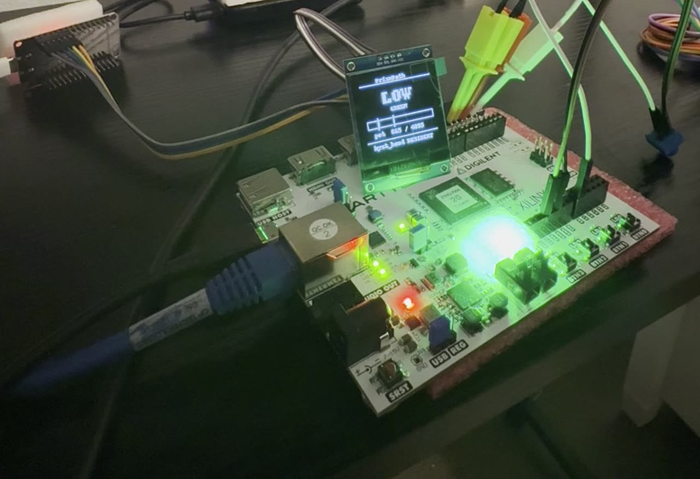

# prismpath-hw · the FPGA sprint workspace

*A top-level target directory of the PrismPath repo, beside `prismpath-rs/` and
`prismpath-go/`; built off to the side during the FPGA sprint and landed after clearing the
repo's gates. The claim, delivered and measured: a **fixed circuit** routes any conformant
Level M flow loaded as a **BRAM table image**: the flow stays data all the way down to
silicon.*

## See it decide

[](https://github.com/crystal-warden/prism-path/releases/download/demo-2026-08/prismpath-demo-take4.mp4)

**Two minutes, one take.** A button press swaps signed policies from a ROM inside the FPGA fabric, no
processor in the loop; the exact rule flickers honestly on a knife edge threshold while the resident rule
holds the same dial rock steady under signed deadbands, and then the input becomes a sensor carried across
the room, deciding over a radio mesh the chip decodes itself. Every decision wrote a receipt, and the whole
chain (4568/4568 silicon replay, a live sweep witness, the worst case bound on the pins) ships as one
hashed, Bitcoin anchored manifest you can verify in six commands:
[`hyst-cert/VERIFY.md`](hyst-cert/VERIFY.md).

## Layout

| file | role |
|---|---|
| [TABLE_FORMAT.md](TABLE_FORMAT.md) | PPT v1 image format + the declared v0 subset + engine-parity semantics |
| [ppt_compile.py](ppt_compile.py) | `compile --target table`: condition/flow → binary image + JSON debug view |
| [interp.c](interp.c) | the C target: behavioral twin of the future RTL, same images |
| [run_vectors.py](run_vectors.py) | certification: frozen conformance corpus → C target, subset-filtered with reasons |
| [ppt_eval.h](ppt_eval.h) | the embedded evaluator every firmware includes: no allocation, static buffers sized by three macros, return codes instead of exits |
| [interp_hdr.c](interp_hdr.c) | ppt_eval.h driven on the host with interp.c's command line, so `make cert` certifies the header against the same corpus |
| [eval_copies_check.py](eval_copies_check.py) | which firmwares include ppt_eval.h and which still carry a local copy pending a hardware recertification |
| [EVALUATOR_WALKTHROUGH.md](EVALUATOR_WALKTHROUGH.md) | interp.c and ppt_eval.h read in plain language: one paragraph per function, pseudocode, the three substrates side by side, and the deliberate differences |
| [PPT_FORMAT_WALKTHROUGH.md](PPT_FORMAT_WALKTHROUGH.md) | one signed policy followed from the compiler through `validate_image` to the interpreter on the fabric, with every hand kept mirror of the layout named |
| [esp-vision-node/WIRE.md](esp-vision-node/WIRE.md) | every record on the vision bench's links, camera, relays, sniffer and bench apps, in one contract |
| [esp-vision-node/FRONT_END.md](esp-vision-node/FRONT_END.md) | the camera front end: what a cell value is in gray levels, what the thresholds mean, the anchored normal's state machine, and one paragraph per function |
| [esp-vision-c6/RELAY_WALKTHROUGH.md](esp-vision-c6/RELAY_WALKTHROUGH.md) | the two relays as one story: the queues and the priority rule, the downlink window, the power policy and its signed decision record, reassembly and the room verdict |
| [rtl-tb/README.md](rtl-tb/README.md) | the testbench index: one row per testbench, what it certifies, against which corpus, and the command that gates it |
| [compile_flows.py](compile_flows.py) | sweep every repo flow; images land in `build/flows/` |

```sh
make            # build the C interpreter
make cert       # certify interp.c and ppt_eval.h against the conformance vectors, then check the firmware copies  (THE day-1 gate)
make -C tb gate # certify rtl/ppt_interp.sv against the same corpus under Verilator and cocotb  (THE RTL gate)
python3 -W ignore compile_flows.py
```

The fabric is no longer one interpreter with one testbench. `rtl/` now holds the policy interpreter
`ppt_interp.sv`, the control interpreter `ppt_ctrl_interp.sv` that drives it from buttons and a
signed control table, and the loader, mux, field control and receipt modules around them; the eight
cocotb testbenches in `rtl-tb/` cover them one module or composition at a time. Every Makefile there
includes [rtl-tb/gate.mk](rtl-tb/gate.mk), so `make -f Makefile.<name>` runs the simulation **and**
judges it, and [rtl-tb/README.md](rtl-tb/README.md) has the row and the command for each one. A bare
`make sim` anywhere in this repository exits 0 even when a cocotb test fails, so it is a rendering
step and never a pass or fail check.

## Components

Each directory is one substrate or one demo; all of them decide from the same compiled `.ppt`
images and are judged against the same frozen conformance corpus.

| directory | what it holds |
|---|---|
| `rtl/`, `rtl-tb/`, `tb/` | the fixed interpreter circuit (`ppt_interp.sv`: runtime load port, field register file, comparator atoms, per-edge stack machine, priority encoder, saturating visits bank), its AXI-Lite wrapper `ppt_axi.sv`, the control interpreter and the modules around them, with the Verilator and cocotb benches that certify them |
| `vivado/`, `pynq/`, `deploy.sh` | the Vivado batch scripts that build the overlay (`ppt_overlay.bit` and `.hwh`), the PYNQ runtime that hot-reloads a table over MMIO, and the board bring-up checklist in [`pynq/BOARD_BRINGUP.md`](pynq/BOARD_BRINGUP.md) |
| `bridge/` | the host side of the live sensor demo: field bridges from a BNO086 sensor to the interpreter, with a read watchdog and a staleness detector |
| `avr/` | the same evaluator on an ATmega328P (a stock Arduino Uno R3), tables streamed over serial |
| `rp2350/` | the evaluator on the Pico 2, built for both the ARM Cortex-M33 and the Hazard3 RISC-V core from one source, plus `ppt_tof.c`, a VL53L0X time-of-flight proximity policy that decides on device |
| `esp/`, `esp-*` | the evaluator over ESP-IDF on the ESP32 (Xtensa) and ESP32-C6 (RISC-V), and the sensor, fusion, vision and relay nodes built on it |
| `mesh/`, `mesh-fusion/` | three ESP32s swapping policy together over ESP-NOW with a two phase commit, and the fusion variant with a field test logger |
| `spiral-node/`, `spiral-mesh/` | the spiral packing profile on the air: Facet streams over ESP-NOW between nodes, with the referee scripts that check them |
| `walker-demo/`, `demo/`, `demo-display/` | the demo flows and signed packs, the walker demo's firmware and host scripts, and the display demo flow |
| `hyst-cert/` | the silicon certification harness for the signed hysteresis policy and the resident-band OLED driver, with [`VERIFY.md`](hyst-cert/VERIFY.md) |
| `codec-bench/` | the codec measurement on AVR and ESP32, with `results.md` |
| `evidence/` | the frozen results (logs, certification JSON, the certified bitstream pair, hashed manifests with OpenTimestamps proofs) |

## Build and run

- **The C target and its certification** need only a C compiler and Python: `make` then `make cert`.
- **The RTL gate** (`make -C tb gate`) needs Verilator and cocotb. cocotb is pinned to 1.9.2 because
  2.x requires Verilator 5.036 or later and some distributions still ship 5.020.
- **The overlay** is built with Vivado 2023.2 in batch mode (`vivado/build_overlay.tcl`); the Zynq PS
  is configured from the extracted preset in `vivado/ps7_preset.tcl`, and the interpreter is attached
  as an AXI-Lite module reference through the plain-Verilog shim `ppt_axi_top.v`, because block
  design module references refuse a SystemVerilog top. The certified pair is committed under
  `evidence/`.
- **The board** is a PYNQ-Z1 image v3.1.1 on an Arty Z7-20. Set the board up
  with the PYNQ image's own instructions; `pynq/ppt_pynq.py` is the hot-reload fabric
  router and `deploy.sh` compiles a flow and sends it to the board. PYNQ v3 needs `sudo` with the
  pynq virtual environment sourced, and the server should run from a directory that does not hold a
  folder named `pynq`, which would shadow the package. Reprogramming the PL under an active auto
  design hard wedges the ARM, so the loader quiesces first.
- **MCU builds**: `avr/Makefile` (avr-gcc, no Arduino core), `rp2350/Makefile` (`make arm`,
  `make riscv RISCV_TOOLCHAIN=<dir>`), and ESP-IDF projects for `esp/`, `mesh/` and the vision nodes.
  Each has a `certify_*.py` that runs the frozen corpus against the device over its wire.

## What it has shown

Every figure below is recorded in `evidence/` or in the directory named, and indexed in the
[supporting evidence](../docs/research/supporting-evidence.md) by the number in parentheses.

- **One frozen corpus, many substrates.** The C target certifies 124 in-subset predicate vectors
  of 1,079 and 6 of 6 engine vectors, with zero divergence, and recompiles are byte identical. The
  same 124 predicate vectors certify on the ATmega328P, on both cores of the RP2350 and on the ESP32,
  with the excluded vectors itemized identically to the C target; with the Python, JS, Rust and Go
  kernels, the in kernel eBPF program and the Zynq fabric, they all decide identically. Multi hop
  engine vectors on the AVR are a declared non-goal; it decides predicates and single hops only.
  (#97, #98.)
- **The fabric.** `ppt_interp.sv` is RTL conformant under Verilator and cocotb against the 114
  predicate and 6 engine vectors of the original corpus. The full RTL re-sweep to 124 of 1,079 is held
  for a hardware retest, so the RTL stands at its 114 of 1,067 sweep. Timing closes at a 50 MHz fabric
  clock (100 MHz missed by 5.23 ns on the single cycle atom path), with 1,064 LUTs (2.0%) of the
  XC7Z020. Evaluating takes 5 to 21 cycles on `incident_severity`, which is 100 to 420 ns worst case.
  A 136 byte image routed live sensor fields on the board at a median 96 µs round trip (89 to 202 µs)
  including the Linux and Python path.
- **Worst case bound.** The per policy WCET ships signed in every pack manifest (`wcet_cycles`,
  recomputed at verify). The formal campaign corrected the universal bound to `3E + P` plus 8 framing
  cycles, which is 408 cycles or 8.16 µs at 50 MHz at the 48 and 256 caps. The invariant base case is
  proven; the unbounded induction step is honestly open. The unmodified interpreter also closes timing
  on a Lattice ECP5 through the open Yosys and nextpnr flow (Fmax 31.6 MHz); an iCE40 does not fit at
  these caps. (#109 to #112.)
- **The mesh.** Three ESP32s swap policy together: a PREPARE broadcast, every follower re-hashing the
  table and checking its id against a baked allowlist before staging, an ACK, and on quorum a COMMIT at
  a shared tick. The fleet flips together within 0.7 ms. The FNV-1a id and allowlist stand in for a
  signature, with Ed25519 on the mesh the named follow on. (#100.)
- **On device decisions.** The RP2350 reads a VL53L0X over I2C and runs a signed proximity policy with
  no host in the loop, flipping at the authored 100, 300 and 800 mm thresholds. (#99.)
- **Decisions entirely in fabric.** The datapath overlay reads the XADC pot, evaluates, and drives a
  per node LED colour carried inside the signed image, all in the fabric; with no interpreter running
  on the processor the LED kept answering the knob. (#113.)
- **The spiral profile on the air.** A baked sidecar derived from the signed flow equals the derived
  value on an ESP32, and three braided Facet streams over ESP-NOW carried 1,891 frames with zero
  corrupt and zero wrong symbols, derived equal to air on 444 of 444 band symbols. (#114 to #116.)
- **The signed hysteresis policy on silicon.** The 4568 of 4568 silicon replay, the live sweep witness
  and the worst case bound on the pins ship as one hashed, Bitcoin anchored manifest, verified in six
  commands by [`hyst-cert/VERIFY.md`](hyst-cert/VERIFY.md).

## Known limits

- The `.ppt` format is a declared v0 subset (see [TABLE_FORMAT.md](TABLE_FORMAT.md)); every excluded
  vector carries a machine readable reason, and 8 of the 23 repo flow files table compile when swept
  by `compile_flows.py`.
- `model_check._atom_reason` accepts `is` and `is not` as Level M while the evaluator rejects them, a
  classifier and evaluator disagreement upstream of this directory.
- The bitstreams and measurements in `evidence/` are point in time records; the live source has moved
  on in places (the interpreter has been hardened and reflowed since the WCET witness), and
  [`tools/evidence_check.py`](../tools/evidence_check.py) separates the manifests that must still match
  the tree from the ones that are snapshots.

## Backlog

- **100 MHz fabric clock**: overlap prog fetch / atom eval; ~2× latency win for ~30 lines of
  RTL, acceptance gates included. Deferred deliberately; PR-sized on purpose.
